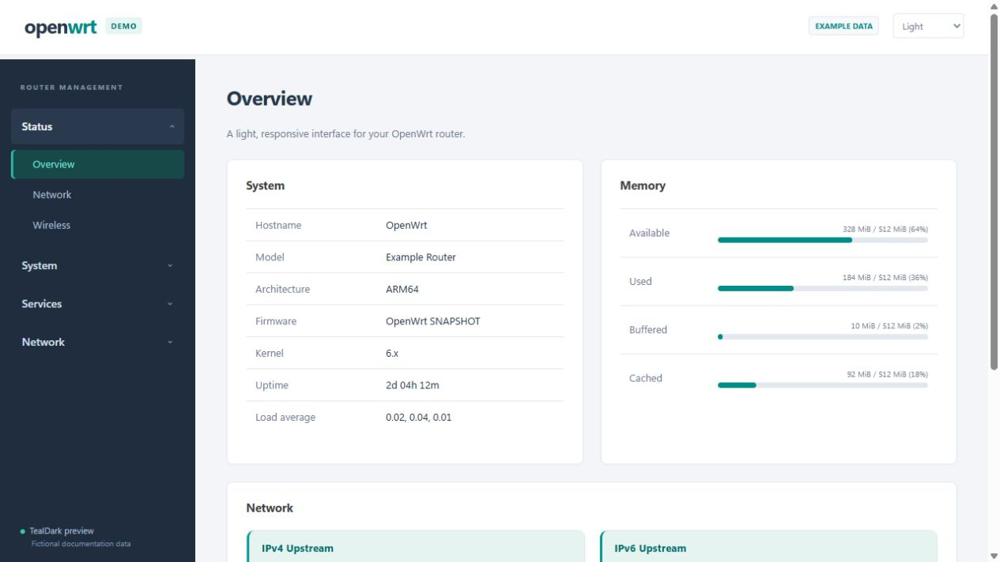
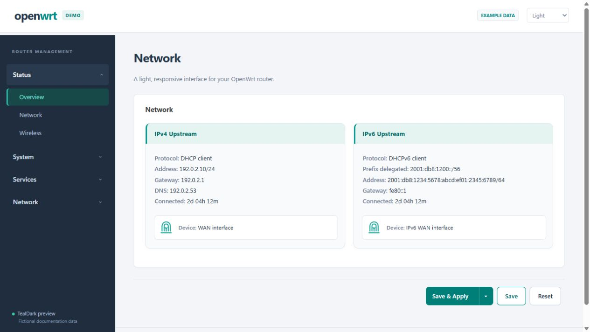
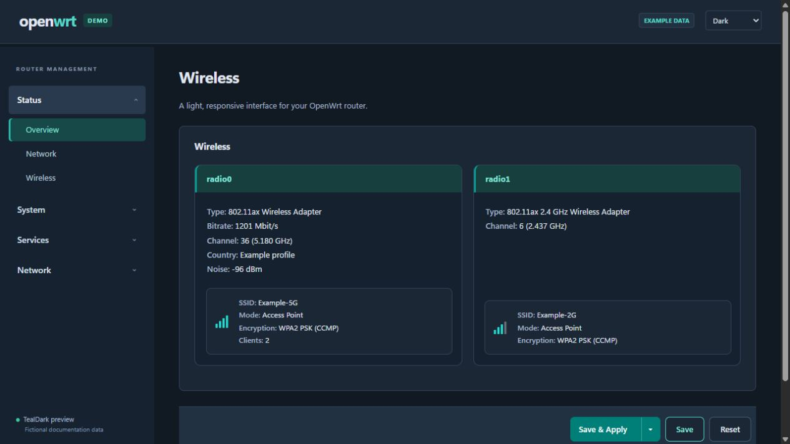

# TealDark for modern LuCI

HG633 projesindeki açık kartlar, koyu sol menü ve turkuaz renklerin güncel LuCI için bağımsız tema uyarlaması. Açık, koyu ve sistem görünümü; telefon menüsü; LuCI'nin dinamik menüleri, tabloları ve modalları desteklenir.

İlk doğrulanan ortam: Zyxel NBG7815, OpenWrt SNAPSHOT r0-90835e2, LuCI Master 26.324.30275~618fbc9, APK 3.0.5. Paket `noarch` olarak hazırlanmıştır. Aynı güncel LuCI şablon arayüzünü kullanan cihazlara yöneliktir; eski Lua tabanlı LuCI sürümleri için değildir. Başka LuCI sürümleri ve tüm üçüncü taraf uygulamalar henüz donanımda denenmedi.

[Download APK and checksums](https://github.com/ozgunokan/luci-theme-tealdark/releases/tag/v1.0.0-r6)

## IPK / opkg kurulumu

`opkg` kullanan, modern **ucode tabanlı LuCI** kurulu cihazlar için ayrıca `luci-theme-tealdark_1.0.0-r6_all.ipk` yayınlanır. IPK biçimi eski Lua-only LuCI ile uyumluluk sağlamaz. APK ve IPK aynı 26 tema dosyasını içerir; cihazın paket yöneticisine uygun olanı kullanın.

```sh
opkg install /tmp/luci-theme-tealdark_1.0.0-r6_all.ipk
uci set luci.main.mediaurlbase='/luci-static/tealdark'
uci commit luci
```

Tarayıcıda Ctrl+F5 ile yenileyin. Kaldırmak için `opkg remove luci-theme-tealdark` kullanılır. Bootstrap kurulu tutulmalıdır. IPK, OpenWrt'nin gzip/tar paket düzenini kullanır; mimarisi `all` olarak belirtilir. Paket yapısı, dosya/izin eşleşmesi, tekrarlanabilir üretim ve izole kurulum/kaldırma betikleri test edilmiştir; **opkg kullanan gerçek cihazda kurulum henüz denenmedi**. Donanım testi APK sürümüyle yapıldı.

IPK'yi tekrar üretmek için `python3 tools/package-ipk.py` çalıştırın. İzole test: `python3 tests/ipk.test.py` (POSIX `sh` gerekir). IPK ve güncellenmiş kaynak ZIP'i için `IPK-SHA256SUMS` dosyasını kullanın.

## Kurulum

APK dosyasını cihazın `/tmp` dizinine kopyalayın. Bu yerel paket henüz bir depo anahtarıyla imzalanmadığı için yalnız bu dosyanın kurulumunda `--allow-untrusted` kullanılır:

```sh
apk add --allow-untrusted /tmp/luci-theme-tealdark-1.0.0-r6.apk
uci set luci.main.mediaurlbase='/luci-static/tealdark'
uci commit luci
```

Tarayıcıda Ctrl+F5 ile yenileyin. Tema System → System → Language and Style bölümünden de seçilebilir. Sağ üstteki Automatic / Light / Dark seçimi tarayıcıda saklanır.

Tema yalnız LuCI görünümünü değiştirir. HG633'e özel servisleri, ayar işleyicilerini, RF/DSL kodunu veya cihaz ayarlarını taşımaz. Overview, kurulu LuCI'nin kendi gerçek sistem/bellek/ağ bölümlerini kullanır. Yalnız örnek verilerle çizilmiş ayrı bir durum ekranı değildir.

## Geri dönüş ve kaldırma

```sh
uci set luci.main.mediaurlbase='/luci-static/bootstrap'
uci commit luci
```

Sayfayı yeniledikten sonra isterseniz paketi kaldırın:

```sh
apk del luci-theme-tealdark
```

Bootstrap teması kurulu tutulmalıdır. Paketin kaldırma işlemi, TealDark seçiliyse Bootstrap'a döner. Kaldırıp yeniden kurma davranışı ayrıca otomatik testle doğrulanır.

## Kaynaktan derleme

Bu klasörü güncel LuCI kaynağında `themes/luci-theme-tealdark` konumuna koyun ve OpenWrt SDK/buildroot içinde tema paketini seçin. `Makefile`, LuCI'nin standart `luci.mk` kurallarını kullanır. `LUCI_PKGARCH=all`, SDK tarafından hedef paket biçiminin mimariden bağımsız alanına dönüştürülür.

Dağıtılan APK ayrıca resmî apk-tools 3 `mkpkg` oluşturucusuyla hazırlanmıştır. Tekrarlamak için `tools/package-apk.sh` aracına `mkpkg` özelliği olan `APK_TOOL` yolunu verin. Sisteminizdeki kırpılmış OpenWrt `apk` ikilisi bu oluşturma komutunu içermeyebilir. Paket dosyalarının sahipliği root/root olmalıdır; SDK derlemesi bunu kendi araçlarıyla sağlar.

## Doğrulama

Hedef cihazda ucode şablon derlemesi, APK kurulum simülasyonu/kurulumu, açık-koyu görünüm, mobil menü ve yatay taşma kontrolü; Overview, Interfaces ve Wireless sayfaları test edildi. Tarayıcı hata kaydı ve ağ ayarlarının/boot kimliğinin korunması kontrol edilir. Tam uygulama uyumluluğu için `TEST-REPORT.json` kapsamına bakın.

Menü, kullanıcının LuCI oturumunun izin verdiği menü ağacından üretilir. Kimlik doğrulama, güvenlik uyarıları, kaydetme/uygulama, DHCP, DNS ve kablosuz ayarları LuCI tarafından yönetilir.

## Lisans

Apache-2.0. LuCI Bootstrap temeli OpenWrt/LuCI ekibine aittir. HG633 TealDark tasarımı bu proje tarafından uyarlanmıştır. Kaynak girdileri ve hash'leri `UPSTREAM.json` içinde bulunur.

## 1.0.0-r3 görünüm düzeltmeleri

Interfaces ve Wireless rozetleri sade SVG simgelerle temaya uyarlandı; yerel araç ipuçları korunur. Güvenlik bölgesi rengi büyük başlık yerine ince bir kenar işareti olarak gösterilir. Ana sayfa ve düzenleme penceresindeki seçili sekmeler turkuaz bir zeminle belirginleştirildi. Status'taki System/Memory kartları, sabit piksel yüksekliği kullanılmadan aynı satırda eşit yüksekliğe gelir. Mobilde kartlar ayrı satırlara döner.

Bu sürüm CSS/SVG düzenlemesidir; ağ, kablosuz, DHCP veya güvenlik duvarı ayar işleyicilerini değiştirmez.

## 1.0.0-r4 Overview ve tipografi

Overview'daki Network ve Wireless kartları mevcut alanı eşit paylaşır; dar ekranda alt alta yerleşir. Bu gruplar, Interfaces listesindeki kompakt kutuların genişlik sınırını artık kullanmaz. Uzun IPv6 adresleri, cihaz açıklamaları ve kablosuz bilgiler kutu içinde kaydırılmadan okunabilir. Metinler kısaltılmaz; LuCI'nin gerçek verisi korunur.

Tipografi yerel Segoe UI Variable / sistem sans-serif font yığını, daha okunaklı boyutlar, tutarlı ağırlıklar ve hizalı rakamlarla düzenlendi. Harici font servisi, font indirmesi veya üçüncü taraf istek eklenmedi. Kod ve log alanları monospace kalır.

## 1.0.0-r5 Save ve Apply kontrolleri

Save düğmesinin yazı/zemin kontrastı açık ve koyu görünümde düzeltildi. Save & Apply, Save ve Reset aynı yüksekliğe hizalandı. Native Apply menüsü korunur; tema bu eylemlerin davranışını değiştirmez.

## Screenshots

Documentation previews use fictional data. The installed theme displays native LuCI data.







## 1.0.0-r6 Login

Giriş formu ortalanmış bir kartta gösterilir. Kullanıcı adı, parola ve giriş düğmesi tek kart içindedir; boş menü ve çıkış bağlantısı giriş ekranında gizlenir. Açık/koyu görünüm ve telefon genişliği kontrol edildi. Şifresiz root uyarısı giriş ekranında gizlenir ve girişten sonra yönetim panelinde görünür. Hata mesajları, ek kimlik doğrulama alanları ve LuCI giriş işleyicisi korunur. Giriş sonrası normal gezinme geri gelir. Kimlik doğrulama davranışı değiştirilmez.
